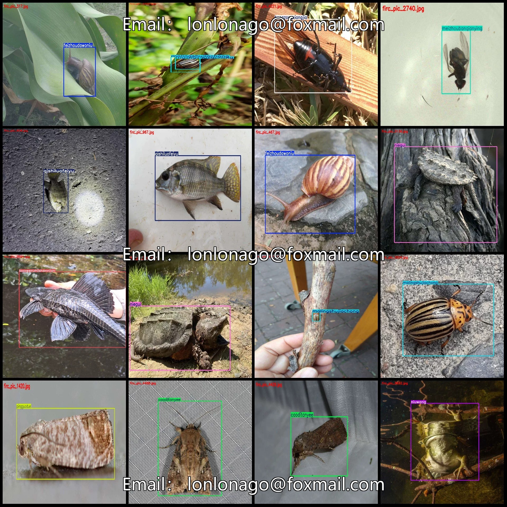
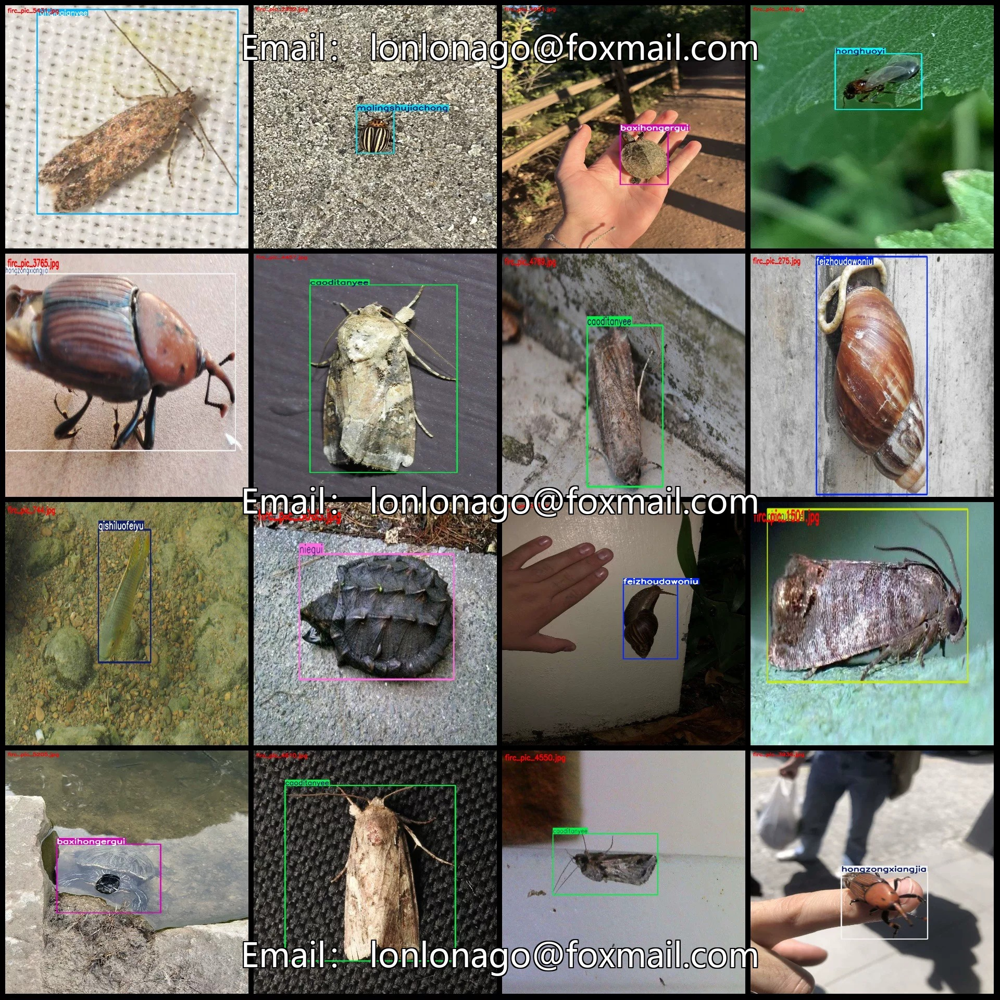
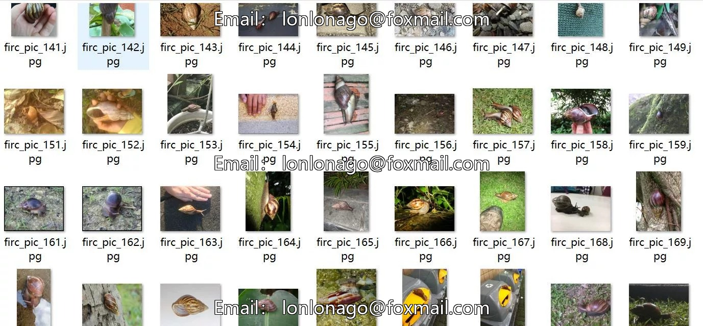
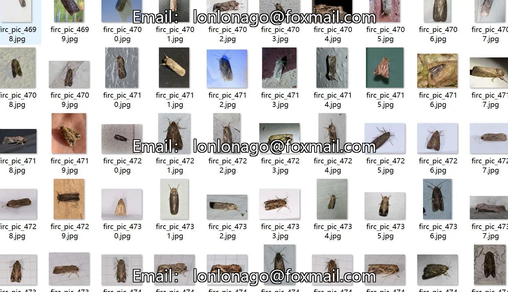
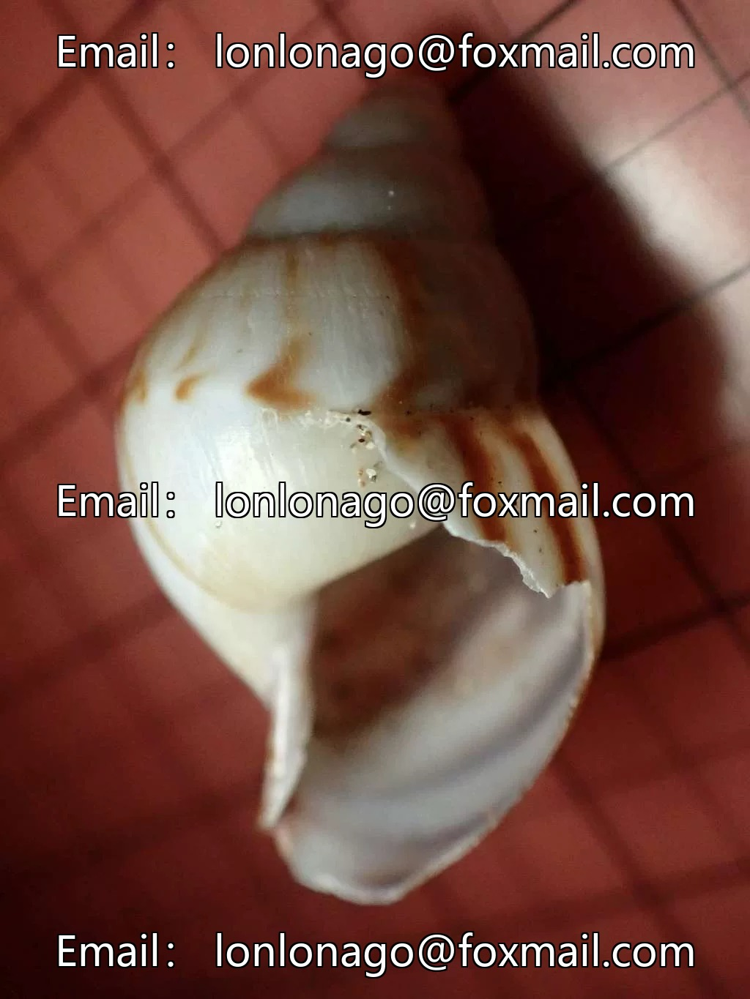
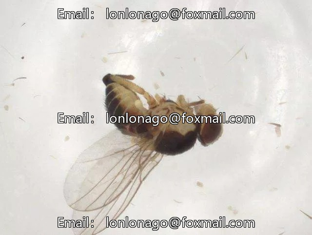
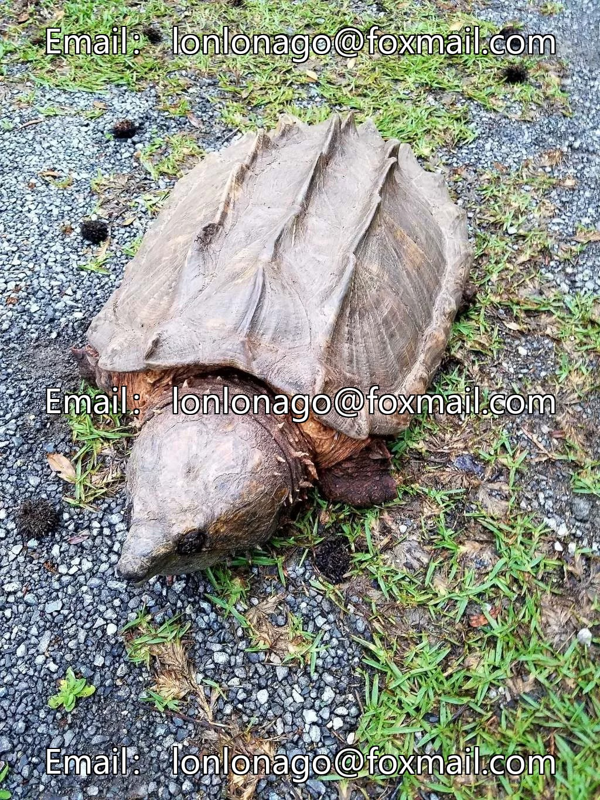

# Foreign Invasive Species Detection Dataset VOC+YOLO format: 5537 images in 18 categories

## Body

Foreign Invasive Species Detection Dataset: VOC+YOLO format, 5537 images in 18 categories
Tips: Due to the dataset's replicability, please confirm compliance before purchasing.
Dataset format: PascalVOC format + YOLO format (txt file without split path, only containing jpg images and corresponding VOC format xml files and yolo format txt files)
Number of images (number of jpg files): 5537
Number of annotations (number of xml files): 5537
Number of annotations (number of txt files): 5537
Number of annotation categories: 18

Label category names (Note that the order of categories in the YOLO format does not correspond to this, but is based on the labels folder's classes.txt): ["baowenzhishennian", "baxihongergui", "caoditanyee", "daoshuixiangjia", "equeguan", "fanqieqianyee", "feizhoudawoniu", "fushouluo", "honghuoyi", "hongzhidaxiaodu", "hongzongxiangjia", "malingshujiachong", "mei"]

Guobaie, Meizhou Banqingying, Niegui, Niuwang, Pingguodue, Qishilufeiyu

[Leopard-spotted catfish], [Brazilian Red-eared Terrapin], [Grasshopper Pest], [Paddy Weevil], [Alligator Garp], [Tomato Leaf Miner], [African Snail], [Fusarium Worm], [Red Fire Ant], [Red Grass Moth], [Red Palm Weevil], [Potato Beetle], [American White Butterfly], [South American Macrocerus], [Broad-mouthed Frog], [Apple Moth], [Zebra Mussel], [Corydoras Catfish], [Mudskipper Fish], [Golden Mantis Shrimp], [Bream Fish], [Apple Maggot], [Chicken of the Sea], [Siamese Nile Tilapia
Number of boxes and the number of images occupied by each category
Baowenzhishennian frame count = 44, occupying image count = 41
Baxihongergui Frames = 430, Pictures Taken = 377

caoditanyee Frames = 427, Pictures = 415
daoshuixiangjia Frames = 91, Pictures = 89
equeguan Frames = 207, Pictures = 195
fanqieqianyee Frames = 322, Pictures = 319
feizhoudawoniu Frames = 634, Pictures = 539
fushouluo Frames = 310, Pictures = 221
honghuoyi Frames = 246, Pictures = 199
hongzhidaxiaodu Frames = 72, Pictures = 72

hongzongxiangjia frame count = 537, occupying image count = 528
Malingshujiachong Frames = 721, Pictures = 643
Meiguobaie Frames = 279, Pictures Taken = 256
Meizhoubanqianying frame count = 149, occupy image count = 149
Niegui box count = 450, occupied image count = 445
Niuwang frame count = 93, occupying image count = 91
Pingguodue box count = 726, occupy image count = 693
Qi Shiluofeiyu Frames = 293, Pictures = 265
Total frame count: 6031

Image resolution: Multi-resolution images, such as 1024x1365, 1024x768, etc.
Using labeling tool: labelImg
Labeling rules: Draw a rectangle around the category
Important note: The dataset does not have separate training, validation, and test sets; you need to partition them yourself.
Special declaration: This dataset does not guarantee the accuracy of the trained models or weight files.

## Images

## Payment

Here is a pay link on Stripe ( https://buy.stripe.com/3cs8yP7sY87d0vu9AB ). Please contact me lonlonago@foxmail.com after funding $89, and I will send you a complete data files , thank you!

